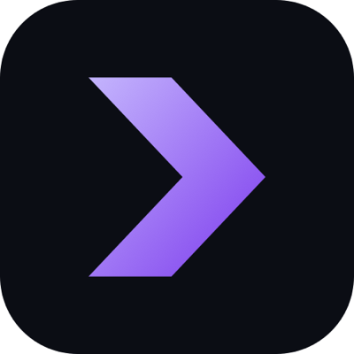

<p align="center"></p>

# SecFeed MCP Server

Hosted MCP server for **SEC EDGAR data**. Gives Claude, Cursor, Cline, VS Code, Windsurf and any MCP client 28 tools for SEC filings, Form 4 insider trades, 13F holdings, XBRL financial statements, 8-K events, executive compensation and more, as clean JSON.

* Endpoint: `https://secfeedapi.com/mcp` (streamable HTTP)
* Auth: `Authorization: Bearer YOUR_KEY`
* Get a key: https://secfeedapi.com/signup/
* Docs and prompt library: https://secfeedapi.com/mcp/

Nothing to install or run locally. The server is remote; you only add it to your client's config.

## Setup

### Claude Code

```bash
claude mcp add --transport http secfeed https://secfeedapi.com/mcp \
  --header "Authorization: Bearer YOUR_KEY"
```

### Cline

Open Cline, click the MCP Servers icon, then Configure, and add this to `cline_mcp_settings.json`:

```json
{
  "mcpServers": {
    "secfeed": {
      "type": "streamableHttp",
      "url": "https://secfeedapi.com/mcp",
      "headers": { "Authorization": "Bearer YOUR_KEY" }
    }
  }
}
```

### Cursor

Add to `~/.cursor/mcp.json` (or `.cursor/mcp.json` in a project):

```json
{
  "mcpServers": {
    "secfeed": {
      "url": "https://secfeedapi.com/mcp",
      "headers": { "Authorization": "Bearer YOUR_KEY" }
    }
  }
}
```

### Claude Desktop

Claude Desktop needs the `mcp-remote` bridge. Add to `claude_desktop_config.json`:

```json
{
  "mcpServers": {
    "secfeed": {
      "command": "npx",
      "args": ["-y", "mcp-remote", "https://secfeedapi.com/mcp", "--header", "Authorization: Bearer YOUR_KEY"]
    }
  }
}
```

Setup pages for VS Code, Windsurf, Gemini CLI and other clients: https://secfeedapi.com/mcp/

## Example prompts

* Find NVIDIA's three most recent 10-K filings and summarize what changed in the Item 1A risk factors.
* Which insiders bought Tesla stock on the open market in the last 90 days, and at what prices?
* What did Berkshire Hathaway's latest 13F add and sell compared with the previous quarter?
* Show Microsoft's revenue, net income and free cash flow for the last five fiscal years.
* List every 8-K Item 4.02 restatement filed this year.

## Tools

| Tool | What it does |
|---|---|
| `search_filings` | Search every EDGAR filing with a Lucene-style query, e.g |
| `full_text_search` | Search the full text of every filing and exhibit since 2001 |
| `extract_section` | Return one item of a 10-K (1, 1A, 7, 7A...), 10-Q (part1item2, part2item1a...) or 8-K (2-2, 5-2...) as clean text |
| `xbrl_to_json` | All financial statements and cover page of one filing as JSON, from its XBRL |
| `financial_statements` | Latest income statement, balance sheet and cash flow (totals only) for a company |
| `company_facts` | Every XBRL fact a company has ever reported (large) |
| `insider_trades` | Form 3/4/5 insider transactions and holdings with owners, prices, footnotes |
| `form_13f_holdings` | 13F holdings rows by CUSIP or filer CIK |
| `events_8k` | 8-K filings by item (1.01, 1.05, 2.02, 4.01, 4.02, 5.02, 5.07...) |
| `structured_form` | Parsed XML forms with every data point |
| `company_profile` | EDGAR entity profile: name, SIC, addresses, fiscal year end, former names |
| `map_ticker` | Ticker to CIK, name and exchange |
| `map_cusip` | CUSIP to issuer name and ticker |
| `shares_outstanding` | Shares outstanding and public float history |
| `auditor` | Auditor name, location and PCAOB ID from the latest annual report |
| `enforcement` | SEC enforcement releases |
| `sro_filings` | SRO rule filings (FINRA, MSRB, DTC, exchanges) |
| `pay_vs_performance` | Pay versus performance table by year from the proxy's XBRL |
| `equity_dilution` | Share counts, dilution, stock comp and buybacks over time |
| `executive_compensation` | Summary Compensation Table by executive and year |
| `directors` | Board members with compensation, age, tenure |
| `subsidiaries` | Subsidiaries from Exhibit 21 |
| `ipo_filings` | Registrations and 424B4 offering terms |
| `mergers_acquisitions` | M&A filings: merger proxies, tender offers, 425, S-4 |
| `investment_adviser` | Form ADV adviser firms: search by name or get one by CRD |
| `list_filing_files` | Every file in a filing (documents, exhibits, XBRL) |
| `governance_dataset` | Structured data extracted from proxy statements, auditor's reports and SEC enforcement releases |
| `audit_report_text` | Full text of one auditor's report, by the id from the audit-reports datasets |

## Also available as

* REST API: https://secfeedapi.com/docs/ (OpenAPI spec: https://secfeedapi.com/openapi.json)
* Python SDK: `pip install secfeed`
* Node.js SDK: `npm install secfeed`
* RapidAPI: https://rapidapi.com/secfeedapi/api/secfeed-sec-edgar-api

## Support

support@secfeedapi.com

SecFeed is not affiliated with the U.S. Securities and Exchange Commission. Data comes from public SEC EDGAR filings.
